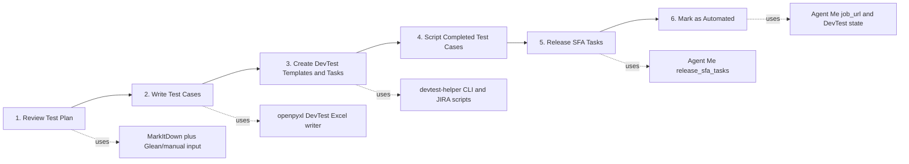

# QA to Automated SFA Agent Workflow

This document maps the manager-facing QA to Automated SFA workflow to the
current `agent-me` implementation and the generated agent skill/rule layer.

## Executive Summary

`agent-me` already automates the Auto SFA execution layer:

- Dashboard `/auto-sfa` has Create SFA Tasks and Release SFA Tasks tabs.
- MCP `/mcp/` exposes schema-only `create_sfa_tasks` and
  `release_sfa_tasks`.
- Jobs stream terminal output through the dashboard and persist trigger
  history.

The generated workflow layer fills the upstream orchestration gap:

- Convert PRD/test-plan inputs into Markdown that agents can reason over.
- Review scope and coverage.
- Generate DevTest-compatible Excel test cases.
- Prepare DevTest template/task commands through `devtest-helper`.
- Keep human review gates before external writes and script placement.
- Provide an autopilot entry point so a user can say
  `execute qa-auto-sfa-workflow` and the agent starts Step 1, asks only for
  missing blocker inputs, and records defaults as assumptions.

## End-to-end Flow



## Step Map

| Step | Agent action | Tooling | Human gate | Output |
|---|---|---|---|---|
| 1. Review Test Plan | Gather PRD/test-plan docs, convert to Markdown, extract coverage | Microsoft MarkItDown, local files, Glean/MCP retrieval | Approve source manifest and assumptions | `intake/manifest.md`, `review/test-plan-review.md` |
| 2. Write Test Cases | Generate DevTest-compatible workbook; bootstrap a fallback workbook if none exists | Python `openpyxl`; ST2110/API sample workbook if provided; `create_devtest_excel_template.py` fallback | Review generated coverage and Excel | `test-cases/devtest-test-cases.xlsx`, `test-case-review.md` |
| 3. Create DevTest Templates and Tasks | Run or prepare DevTest/JIRA commands | `cloud-service-qa/devtest-helper` | Approve external writes and credentials | Template IDs, JIRA task links, runbook |
| 4. Script Completed Test Cases | Draft or implement test scripts | Target automation repo plus pytest conventions | Choose repo/folder/marker before edits | `scripts/script-plan.md`, code patch if approved |
| 5. Release SFA Tasks | Start Auto SFA release job | Agent Me MCP `release_sfa_tasks` | MCP/client approval | `job_url`, dashboard terminal |
| 6. Mark as Automated | Route "mark auto" wording to release flow | Agent Me MCP `release_sfa_tasks` | Same approval as step 5 | DevTest automated coverage tracking |

## Current Implementation in This Repo

Implemented:

- `src/agent_me/auto_sfa.py`: parsers, builders, and `magic-auto` command
  generation for create/update-template and release flows.
- `src/agent_me/auto_sfa_mcp.py`: MCP endpoint with structured-only
  `create_sfa_tasks` and `release_sfa_tasks`.
- `src/agent_me/dashboard/auto_sfa_runner.py`: background jobs, SSE events,
  cancellation, history recording.
- `src/agent_me/dashboard/templates/auto_sfa.html`: dashboard UI for Create
  SFA Tasks, Release SFA Tasks, credentials, terminal output, and history.

Generated in this pass:

- `.cursor/skills/qa-auto-sfa-workflow/SKILL.md`
- `.cursor/skills/qa-auto-sfa-workflow/agents/openai.yaml`
- `.cursor/skills/qa-auto-sfa-workflow/references/*.md`
- `.cursor/skills/qa-auto-sfa-workflow/scripts/create_devtest_excel_template.py`
- `artifacts/qa-auto-sfa-agent-rules.yaml`
- `artifacts/qa-auto-sfa-manager-demo.md`

Not implemented as runtime code yet:

- A first-party MarkItDown wrapper inside `agent-me`.
- A first-party Excel writer endpoint.
- A first-party DevTest template creation endpoint.
- A first-party script-writing queue tied to external test repos.

Those upstream steps are now documented as deterministic agent rules so the
manager demo can show how each step would be delegated, gated, and connected
to the already implemented Auto SFA layer.

## Tool Contracts That Matter

### `create_sfa_tasks`

Use for existing template prep only:

```text
display_name: required
folder_id: required
template_ids: optional
template_ids_enabled: optional
win_linux: optional, default "Linux Only"
```

Effect: runs `magic-auto update-template`, updating matching templates before
release.

### `release_sfa_tasks`

Use for release, auto, and mark-auto wording:

```text
display_name: required
url_path: required
release_type: optional, default "Linux Release"
source_folder_id: optional, default 50722 for Linux Release
devtest_folder_id: optional, auto-resolved when omitted
start_date / finish_date: optional, default last 7 days
task_ids: optional
complexity_level: optional, default L2
```

Effect: starts an Auto SFA job and returns a dashboard `job_url`.

## Manager Demo Narrative

1. Show `artifacts/qa-auto-workflow.png` as the process overview.
2. Open `.cursor/skills/qa-auto-sfa-workflow/SKILL.md` to show the agent
   routing layer.
3. Show `references/intake-and-review.md` for document intake and MarkItDown.
4. Show `references/test-case-excel.md` for the high-level Excel contract.
5. Show `references/devtest-and-auto-sfa.md` for DevTest/JIRA and Agent Me MCP
   tool boundaries.
6. Open `/auto-sfa` or the existing screenshot to show live Create/Release SFA
   execution and history.

The honest message: upstream authoring is now specified as skills/rules; the
productionized execution layer for Auto SFA already exists in `agent-me`.

## Skill Portability

Codex, Claude, and Cursor do not currently share one automatic skill-loading
directory. Keep the repo-local skill as the source of truth, then copy or adapt
it into each agent's native skill/rule location. For this host, the Codex copy
is installed under:

```text
/localhome/local-thaphan/.codex/skills/qa-auto-sfa-workflow
```

The repo copy remains useful for Cursor and for manager review:

```text
.cursor/skills/qa-auto-sfa-workflow
```
